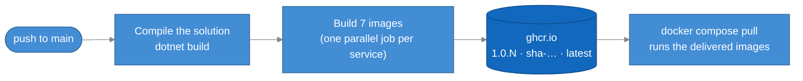
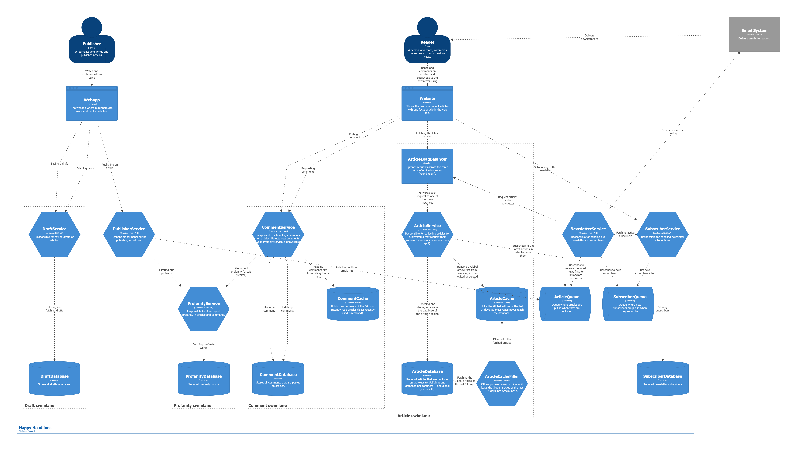

# Week 43 – A CI/CD pipeline that builds every service and delivers versioned images

- **Every push to `main`** starts the pipeline in GitHub Actions
  ([.github/workflows/pipeline.yml](../.github/workflows/pipeline.yml)). It compiles the whole solution and then
  builds a Docker image of each of the 7 services.
- **The images are delivered to the GitHub Container Registry (ghcr.io)**, a central registry, as
  `ghcr.io/christianvistilyth/happy-headlines/<service>`. Each image gets three tags:

  | Tag | Example | Why |
  |-----|---------|-----|
  | `1.0.<run number>` | `1.0.7` | a version number that goes up with every delivery |
  | `sha-<commit>` | `sha-e1f7308` | shows exactly which commit the image was built from |
  | `latest` | `latest` | always the newest version |

- **A pull request is only checked**: compiled and built, but nothing is delivered. Only `main` delivers.
- **No secret to set up**: the pipeline logs in to ghcr.io with the `GITHUB_TOKEN` that GitHub gives every run.

## The pipeline



1. **Compile** – `dotnet build` of [HappyHeadlines.slnx](HappyHeadlines.slnx). If one service doesn't compile,
   the pipeline stops and no image is made (continuous integration).
2. **Build and push the images** – a *matrix*: the same steps run once per service, in parallel. A red job shows
   exactly which service failed, and the others still deliver (continuous delivery).
3. **Use them** – [docker-compose.yml](docker-compose.yml) names the delivered images, so `docker compose pull`
   fetches the newest version from ghcr.io. The `build:` sections are kept, so you can still build locally.

The runs are under **Actions** on GitHub; the images are under **Packages** on the GitHub profile.

## From week 40: ArticleCache and CommentCache

- **ArticleCache** (Redis) holds the Global articles of the last 14 days. ArticleService looks in the cache first
  and only asks the database on a miss. The **ArticleCacheFiller** is an offline process that fills the cache every
  5 minutes. An edited or deleted article is removed from the cache right away.
- **CommentCache** (Redis) holds the comments of the 30 most recently read articles. It is filled on a miss; when a
  31st article comes in, the least recently used article is removed (our own LRU, a Redis sorted set).
- If Redis is down, the services read the database instead: the cache is never on the critical path.
- Hits and misses are counted and sent to Prometheus. The Grafana dashboard **Cache hit ratio** shows the hit
  ratio per cache and the average response time of a hit and a miss.

## C4 container diagram



## Run

The images delivered by the pipeline:

```sh
docker compose pull
docker compose up -d
```

Or build everything locally:

```sh
docker compose up -d --build
```

Demo traffic for the cache dashboard: `docker compose --profile demo up -d traffic`.

| URL | What |
|-----|------|
| http://localhost:3000 | Grafana (logs, traces and the *Cache hit ratio* dashboard) |
| http://localhost:15672 | RabbitMQ – the ArticleQueue (guest / guest) |
| http://localhost:8085/swagger | PublisherService |
| http://localhost:8086/swagger | NewsletterService |
| http://localhost:8081/swagger | ArticleService (through the load balancer) |
| http://localhost:8082/swagger | CommentService |
| http://localhost:8083/swagger | ProfanityService |
| http://localhost:8084/swagger | DraftService |
| http://localhost:8080 | C4 diagrams |

Ready-made requests: [PublisherService.http](src/PublisherService/PublisherService.http), [NewsletterService.http](src/NewsletterService/NewsletterService.http), [ArticleService.http](src/ArticleService/ArticleService.http), [CommentService.http](src/CommentService/CommentService.http), [ProfanityService.http](src/ProfanityService/ProfanityService.http), [DraftService.http](src/DraftService/DraftService.http).
