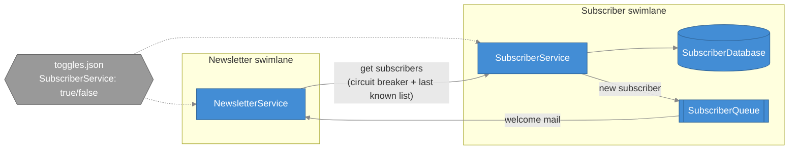
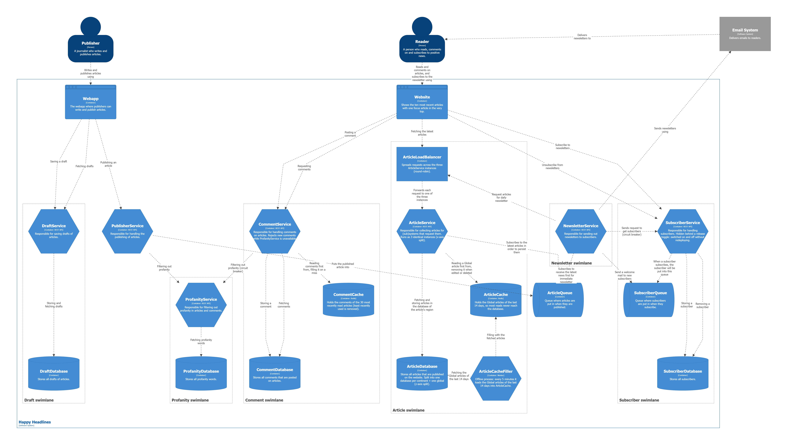

# Week 44 – SubscriberService behind a release toggle, with fault isolation

- **SubscriberService** has its own swimlane: its own service, its own PostgreSQL database and the
  **SubscriberQueue**. Readers subscribe (`POST /api/subscribers`), unsubscribe (`DELETE /api/subscribers/{id}`),
  and NewsletterService asks for the list (`GET /api/subscribers`).
- **NewsletterService** has its own swimlane too. It gets a message on the SubscriberQueue (RabbitMQ) for every new
  subscriber and sends a welcome mail – SubscriberService never waits for it.
- **Fault isolation.** Before every newsletter, NewsletterService asks SubscriberService for the subscribers
  through a **circuit breaker** ([Program.cs](src/NewsletterService/Program.cs)). When SubscriberService is down,
  it uses **the last list it received** ([SubscriberList.cs](src/NewsletterService/Clients/SubscriberList.cs)), so
  a failure in the Subscriber swimlane never stops a newsletter.
- **Release toggle.** SubscriberService is deployed, but only *released* while `SubscriberService` is `true` in
  [toggles/toggles.json](toggles/toggles.json). Both services re-read the file every few seconds, so it is switched
  on and off **without rebuilding, restarting or redeploying** anything (deploy ≠ release).

## The two swimlanes



## The release toggle

```json
{ "FeatureManagement": { "SubscriberService": true } }
```

| | Toggle **on** | Toggle **off** |
|---|---|---|
| SubscriberService | normal answers | `404` on every endpoint, as if it didn't exist (`[FeatureGate]`) |
| NewsletterService | asks SubscriberService for the subscribers, sends welcome mails | the old path: no subscriber lookup, newsletters are sent without a list, welcome mails are skipped |

The toggle point in NewsletterService is `GetAsync` in [SubscriberList.cs](src/NewsletterService/Clients/SubscriberList.cs).
Each service re-reads the file on its own, so for a few seconds after a flip the two can disagree. A central
toggle server (e.g. Unleash or LaunchDarkly) would avoid that.

## What happens when …

| … | Result |
|---|---|
| SubscriberService is down | newsletters still go out, to the last known subscribers; after 3 failures the circuit opens and SubscriberService isn't even called for 15 s |
| SubscriberService is back | the circuit goes half-open → closed, the next newsletter uses the fresh list |
| RabbitMQ is down when someone subscribes | `201`, the subscriber is saved, a Warning is logged, no welcome mail |
| an address subscribes twice (any capitals) | `409` |
| the toggle is switched off | see the table above – within a few seconds, no restart |

## From earlier weeks

- **Week 43 – CI/CD.** Every push to `main` compiles the solution and delivers the 8 service images to ghcr.io as
  `ghcr.io/christianvistilyth/happy-headlines/<service>`, tagged `1.0.<run number>`, `sha-<commit>` and `latest`
  ([pipeline.yml](../.github/workflows/pipeline.yml)). Pull requests are only built. Changes reach `main` through
  issues and pull requests ([COLLABORATION.md](../COLLABORATION.md)).
- **Week 40 – caches.** ArticleCache (Redis, filled every 5 min by ArticleCacheFiller) and CommentCache (Redis,
  filled on a miss, LRU of 30 articles); the Grafana dashboard *Cache hit ratio* shows how well they work.

## C4 container diagram



## Run

```sh
docker compose up -d --build
```

Or the images delivered by the pipeline: `docker compose pull` then `docker compose up -d`.

| URL | What |
|-----|------|
| http://localhost:3000 | Grafana (logs, traces and the *Cache hit ratio* dashboard) |
| http://localhost:15672 | RabbitMQ – ArticleQueue and SubscriberQueue (guest / guest) |
| http://localhost:8087/swagger | SubscriberService |
| http://localhost:8086/swagger | NewsletterService (`POST /api/newsletters/daily` sends the daily newsletter now) |
| http://localhost:8085/swagger | PublisherService |
| http://localhost:8081/swagger | ArticleService (through the load balancer) |
| http://localhost:8082/swagger | CommentService |
| http://localhost:8083/swagger | ProfanityService |
| http://localhost:8084/swagger | DraftService |
| http://localhost:8080 | C4 diagrams |

Ready-made requests: [SubscriberService.http](src/SubscriberService/SubscriberService.http), [NewsletterService.http](src/NewsletterService/NewsletterService.http), [PublisherService.http](src/PublisherService/PublisherService.http), [ArticleService.http](src/ArticleService/ArticleService.http), [CommentService.http](src/CommentService/CommentService.http), [ProfanityService.http](src/ProfanityService/ProfanityService.http), [DraftService.http](src/DraftService/DraftService.http).
