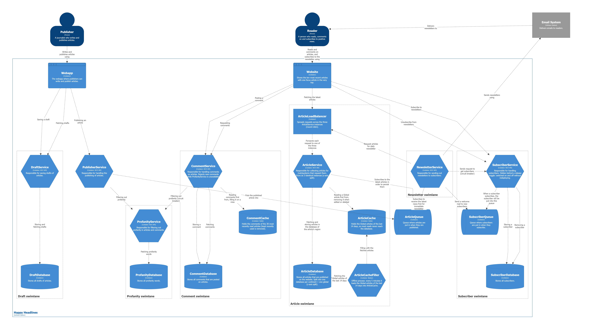
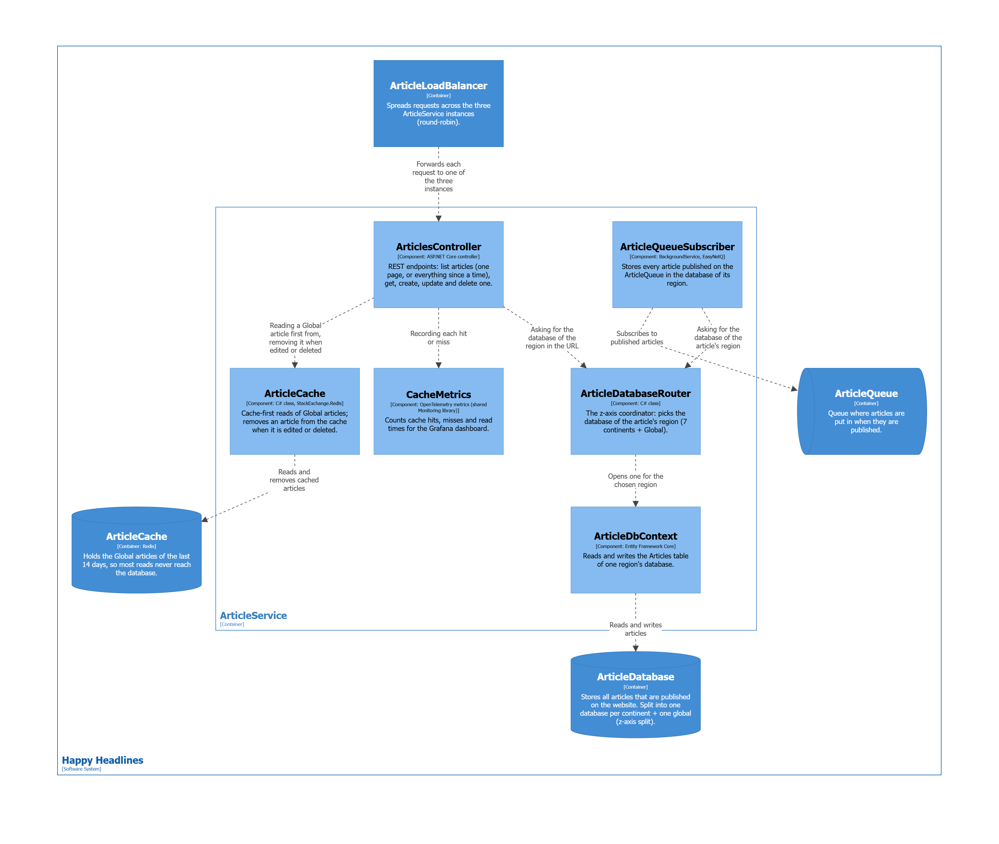

# Week 45 – Sustainability: three tactics from the Green Architecture Framework

Three tactics from Bærbak's [Green Architecture Framework (GAF)](https://baerbak.cs.au.dk/papers/gaf.html) that
Happy Headlines didn't use yet, each measured before and after with [tools/measure.sh](tools/measure.sh).
Why, the code before and after, and the trade-offs are in **[SUSTAINABILITY.md](SUSTAINABILITY.md)**.

| GAF tactic | What changed | Before | After |
|---|---|---|---|
| **Reduce Bundle Size** | all 8 images run on `aspnet:10.0-alpine` instead of the Debian-based `aspnet:10.0` | 1,912 MB | 1,039 MB (−46 %) |
| **Reduce Network Package Size** | the daily newsletter asks ArticleService for `?since=<24 hours ago>` instead of every article | 5,395,668 bytes | 165,830 bytes (−97 %) |
| **Defer Fetching** | the article list returns one page (`?page=&pageSize=`, default 10, max 50) instead of every article | 673,895 bytes | 18,447 bytes (−97 %) |

Energy can't be measured from inside Docker on Windows, so we measure what drives it: MB per image and bytes per
request (GAF process tactic *Measure and Experiment*). The test set: 300 articles per region over 30 days.

## The article list

| Request | Answer |
|---|---|
| `GET /api/regions/{region}/articles` | the 10 newest articles |
| `…/articles?page=2` | the next 10 |
| `…/articles?pageSize=50` | the 50 newest (51 or more → `400`) |
| `…/articles?since=2026-11-09T06:00:00Z` | every article published after that time (not cut into pages) |

## From earlier weeks

- **Week 44 – SubscriberService** in its own swimlane, behind a **release toggle** in
  [toggles/toggles.json](toggles/toggles.json) (on/off without redeploying). NewsletterService gets the subscribers
  through a **circuit breaker** and falls back to the last known list ([SubscriberList.cs](src/NewsletterService/Clients/SubscriberList.cs)).
- **Week 43 – CI/CD.** Every push to `main` compiles the solution and delivers the 8 images to ghcr.io, tagged
  `1.0.<run number>`, `sha-<commit>` and `latest` ([pipeline.yml](../.github/workflows/pipeline.yml)). Changes reach
  `main` through issues and pull requests ([COLLABORATION.md](../COLLABORATION.md)).
- **Week 40 – caches.** ArticleCache (Redis, filled every 5 min by ArticleCacheFiller) and CommentCache (Redis,
  filled on a miss, LRU of 30 articles), with the Grafana dashboard *Cache hit ratio*.

## C4 diagrams

Level 2 – containers:



Level 3 – the components inside ArticleService:



## Run

```sh
docker compose up -d --build
```

Or the images delivered by the pipeline: `docker compose pull` then `docker compose up -d`.

| URL | What |
|-----|------|
| http://localhost:3000 | Grafana (logs, traces and the *Cache hit ratio* dashboard) |
| http://localhost:15672 | RabbitMQ – ArticleQueue and SubscriberQueue (guest / guest) |
| http://localhost:8081/swagger | ArticleService (through the load balancer) |
| http://localhost:8082/swagger | CommentService |
| http://localhost:8083/swagger | ProfanityService |
| http://localhost:8084/swagger | DraftService |
| http://localhost:8085/swagger | PublisherService |
| http://localhost:8086/swagger | NewsletterService (`POST /api/newsletters/daily` sends the daily newsletter now) |
| http://localhost:8087/swagger | SubscriberService |
| http://localhost:8080 | C4 diagrams |

Ready-made requests: [ArticleService.http](src/ArticleService/ArticleService.http), [CommentService.http](src/CommentService/CommentService.http), [ProfanityService.http](src/ProfanityService/ProfanityService.http), [DraftService.http](src/DraftService/DraftService.http), [PublisherService.http](src/PublisherService/PublisherService.http), [NewsletterService.http](src/NewsletterService/NewsletterService.http), [SubscriberService.http](src/SubscriberService/SubscriberService.http).
